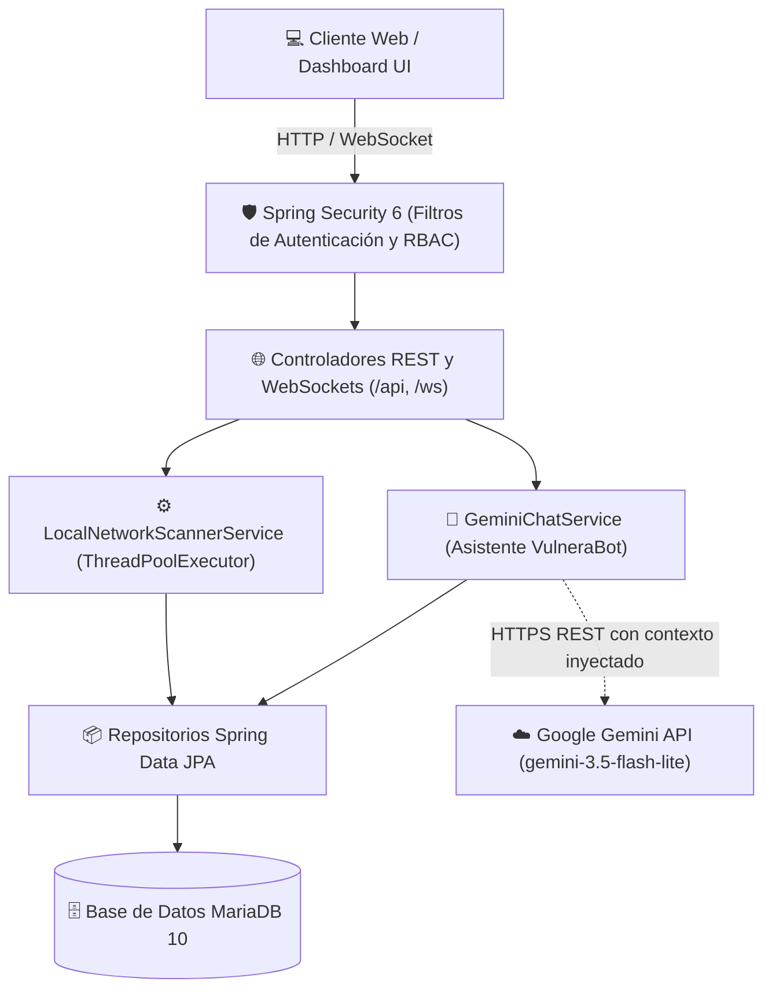
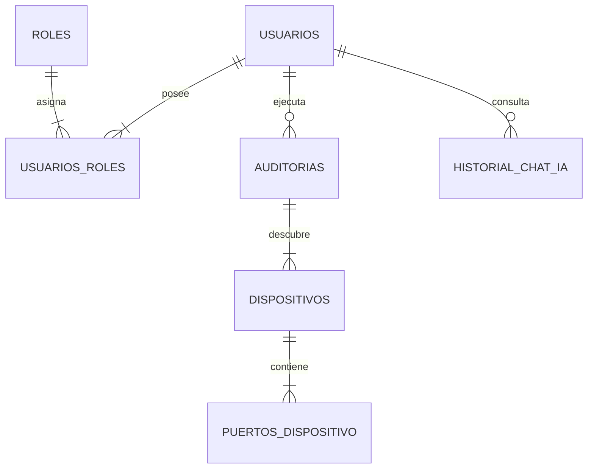
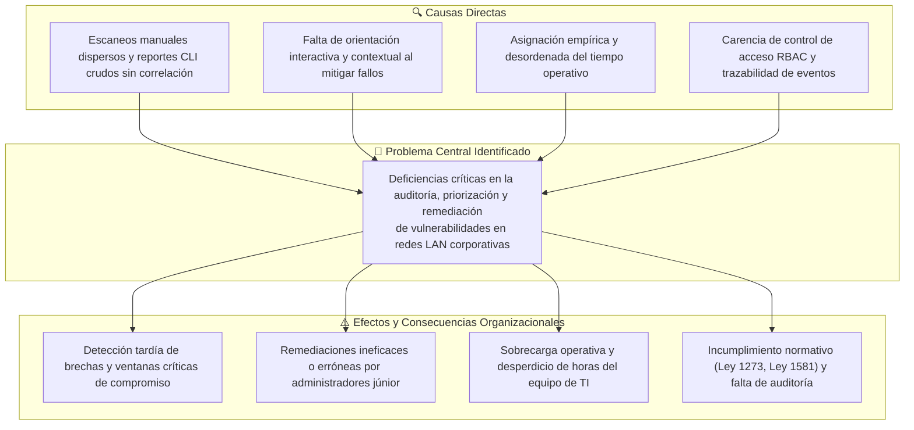

# 🛡️ VulneraSolve — Plataforma web de auditoría de redes LAN con IA y optimización operativa

[](https://www.oracle.com/java/)
[](https://spring.io/projects/spring-boot)
[](https://spring.io/projects/spring-security)
[](https://mariadb.org/)
[](https://ai.google.dev/)

> **VulneraSolve** es una herramienta web diseñada para que administradores de sistemas y equipos de TI puedan auditar de forma fácil y automática la seguridad de su red local (LAN). La plataforma descubre qué computadores están encendidos, qué puertos y servicios tienen expuestos al peligro, te aconseja en tiempo real mediante un asistente con inteligencia artificial (**VulneraBot**) sobre cómo solucionar las fallas, y calcula matemáticamente a qué velocidad debe realizarse la revisión para no saturar el canal de la empresa ni ser bloqueado por los sistemas de seguridad.

---

## 📑 Tabla de contenido
1. [¿Qué es VulneraSolve? (en palabras sencillas)](#-qué-es-vulnerasolve-en-palabras-sencillas)
2. [¿Cómo funciona por dentro? (flujo paso a paso)](#-cómo-funciona-por-dentro-flujo-paso-a-paso)
3. [Diagramas del sistema](#-diagramas-del-sistema)
   - [Diagrama de arquitectura](#1-diagrama-de-arquitectura)
   - [Modelo entidad-relación de la base de datos](#2-modelo-entidad-relación-base-de-datos)
   - [Gráfica de optimización (investigación de operaciones)](#3-modelo-de-optimización-operativa-io)
   - [Árbol del problema](#4-árbol-del-problema)
4. [El asistente inteligente: VulneraBot](#-el-asistente-inteligente-vulnerabot)
5. [Documentación de la API REST (endpoints y ejemplos)](#-documentación-de-la-api-rest-endpoints-y-ejemplos)
6. [Seguridad y cuentas de acceso (RBAC)](#-seguridad-y-cuentas-de-acceso-rbac)
7. [Guía de instalación y puesta en marcha](#-guía-de-instalación-y-puesta-en-marcha)
8. [Guía rápida de estudio para sustentaciones](#-guía-rápida-de-estudio-para-sustentaciones)
9. [Equipo de desarrollo](#-equipo-de-desarrollo)

---

## 💡 ¿Qué es VulneraSolve? (en palabras sencillas)

Imagina una oficina o empresa donde hay 20 o 30 computadores, impresoras y servidores conectados a la misma red de internet. Si alguno de esos computadores tiene un programa antiguo o una "puerta abierta" sin contraseña, un atacante o virus que entre a la red podría meterse a esa máquina y robar información de la empresa.

Normalmente, revisar esto requiere herramientas difíciles de manejar por consola de comandos que arrojan pantallas llenas de texto que solo un experto entiende. Además, si revisas la red demasiado rápido, los cortafuegos (*firewalls*) de la empresa detectan una ráfaga extraña de paquetes y te bloquean; pero si revisas muy lento, el escaneo tarda horas.

**VulneraSolve soluciona esto en 4 pasos:**
1. **Revisa la red automáticamente:** Descubre en segundos todos los computadores encendidos y verifica sus puertos con hilos concurrentes en paralelo.
2. **Te muestra el peligro en colores:** Clasifica qué puertos son críticos (muy peligrosos, como Telnet o SMB) y cuáles son comunes (páginas web normales).
3. **Te ayuda con Inteligencia Artificial:** Incluye a **VulneraBot**, un chatbot conectado a Google Gemini que revisa los hallazgos de tu escaneo y te dice exactamente qué comandos ejecutar en Windows o Linux para proteger tu máquina.
4. **Optimiza la velocidad científicamente:** Utiliza un modelo de **Investigación de Operaciones (Programación Lineal)** para calcular el ritmo óptimo de escaneo (50 paquetes/segundo a puertos críticos y 50 a comunes), logrando la máxima velocidad posible sin que el firewall de la red te bloquee.

---

## ⚙️ ¿Cómo funciona por dentro? (flujo paso a paso)

```
[ Usuario Web ] ──(Inicia escaneo)──> [ Spring Boot Controller ]
                                              │
      ┌───────────────────────────────────────┴───────────────────────────────────────┐
      ▼                                                                               ▼
[ 1. Detección NIC ]                                                        [ 2. Base de Datos ]
  Detecta la tarjeta de red                                                   Crea la auditoría
  activa y la subred                                                          en MariaDB con
  (Ej: 192.168.1.0/24)                                                        estado "EN_PROGRESO"
      │                                                                               │
      ▼                                                                               │
[ 3. Barrido ARP / ICMP ]                                                             │
  Descubre qué IPs están encendidas (254 posibles hosts)                              │
      │                                                                               │
      ▼                                                                               │
[ 4. Sondeo Multihilo TCP ]                                                           │
  ThreadPoolExecutor envía paquetes a los puertos clave                               │
  (21, 23, 80, 443, 445, 3389, 8080)                                                 │
      │                                                                               ▼
      ├──────────────────────> [ WebSocket /ws ] ─────────────> [ Dashboard en tiempo real ]
      │                         Envía progreso (0% a 100%)       Barras de carga y tablas vivas
      ▼                                                                               │
[ 5. Guardado de Hallazgos ]                                                          │
  Guarda dispositivos y puertos abiertos clasificados en MariaDB                     │
      │                                                                               │
      ▼                                                                               ▼
[ 6. Asistencia con VulneraBot ] <─────────────────────────── [ El usuario pregunta dudas ]
  Inyecta el inventario de puertos a Google Gemini              "¿Cómo protejo el puerto 445?"
  y responde con comandos exactos de remediación defensiva.
```

1. **Autodescubrimiento de la red:** El backend analiza la interfaz de red física de la máquina auditora (`NetworkInterface`), obtiene la dirección IP local y calcula la máscara CIDR (ejemplo: `192.168.1.0/24`, abarcando desde la `.1` hasta la `.254`).
2. **Descubrimiento de hosts:** Realiza un barrido inicial mediante mensajes de resolución de direcciones (ARP) y solicitudes de eco (Ping ICMP). Si un equipo responde, se marca como dispositivo activo.
3. **Escaneo de puertos en paralelo:** Para cada equipo encontrado, se activa un grupo de hilos (`ThreadPoolExecutor`) que prueba la conexión a los puertos de red con un tiempo de espera de 250 milisegundos por puerto.
4. **Clasificación de riesgo:** Si encuentra puertos como el 445 (SMB) o el 23 (Telnet), los marca en rojo como **CRÍTICO**. Si encuentra el 80 (HTTP) o 443 (HTTPS), los marca como riesgo estándar o bajo.
5. **Transmisión en vivo:** A través de WebSockets (`/topic/scan`), el frontend recibe actualizaciones instantáneas de progreso sin necesidad de recargar la página.
6. **Asistencia y persistencia:** Al finalizar, el escaneo se guarda con fecha, duración y equipos en MariaDB, y queda listo para que el usuario le haga preguntas técnicas a VulneraBot.

---

## 📊 Diagramas del sistema

### 1. Diagrama de arquitectura
Muestra cómo se comunican todas las piezas de la aplicación: el navegador web, el servidor en Spring Boot, la seguridad con Spring Security, la base de datos MariaDB y la nube de Google Gemini.



* **Capa Frontend:** Construida con HTML5 semántico, CSS moderno con estética oscura de ciberseguridad y JavaScript con WebSockets STOMP para recibir las alertas en vivo.
* **Capa Backend (Spring Boot 3.2):** Controladores REST que exponen las rutas del sistema, interceptados por **Spring Security 6** para comprobar si el usuario es Administrador o Auditor.
* **Motor de Escaneo (`LocalNetworkScannerService`):** Orquestador multihilo que interactúa directamente con los sockets de red del sistema operativo.
* **Capa de Persistencia:** Spring Data JPA conectado a **MariaDB 10** para almacenar usuarios, auditorías, dispositivos y mensajes del chat.
* **Capa de Inteligencia Artificial (`GeminiChatService`):** Cliente HTTP que se comunica de forma segura con la API de Google Gemini enviándole el contexto de la red y las reglas de protección.

---

### 2. Modelo entidad-relación (base de datos)
Topología de la base de datos relacional creada en MariaDB, normalizada en Tercera Forma Normal (3FN):



* **`usuarios`**: Guarda los usuarios del sistema (`username`, `email`, `activo`) y la contraseña cifrada con el algoritmo **BCrypt** (nunca en texto plano).
* **`roles`**: Contiene los perfiles de permiso del sistema (`ROLE_ADMIN` y `ROLE_AUDITOR`).
* **`usuarios_roles`**: Tabla intermedia de muchos a muchos que relaciona qué roles tiene cada usuario.
* **`auditorias`**: Registra cada escaneo realizado, la fecha y hora de inicio/fin, la subred evaluada, la duración en segundos, el total de hosts analizados y el usuario que lanzó la auditoría.
* **`dispositivos`**: Guarda cada computador o equipo descubierto en una auditoría (su dirección IP, dirección MAC física, nombre de fabricante y nivel de riesgo global).
* **`puertos_dispositivo`**: Almacena cada puerto TCP abierto encontrado en un dispositivo específico, indicando el número de puerto (ej. 445), el servicio (SMB), su severidad y estado.
* **`historial_chat_ia`**: Guarda las preguntas de los usuarios y las respuestas entregadas por VulneraBot junto a su marca de tiempo.

---

### 3. Modelo de optimización operativa (I.O.)
¿A qué velocidad debemos enviar los paquetes de escaneo? La Investigación de Operaciones nos da la respuesta exacta mediante un modelo de **Programación Lineal**:

#### El problema real:
* Si enviamos paquetes demasiado rápido, los sistemas de defensa de la red (firewalls e IDS/IPS) detectan una ráfaga y nos bloquean de inmediato, o dejamos sin internet a la oficina.
* Si enviamos muy lento, el escaneo tarda demasiado tiempo.

#### Las variables:
* **$X_1$**: Paquetes por segundo enviados a puertos críticos (21, 23, 445, 3389).
* **$X_2$**: Paquetes por segundo enviados a puertos comunes (80, 443, 8080).

#### La fórmula:
* **Función Objetivo:** `Maximizar Z = 1.5(X1) + 1.0(X2)`  
  *(Le damos más valor a revisar puertos críticos porque descubrir una falla grave aporta más seguridad).*
* **Restricción 1 (Sigilo IDS/IPS):** `X1 + X2 ≤ 100`  
  *(El total de paquetes enviados no puede pasar de 100 por segundo para que el IDS no nos bloquee).*
* **Restricción 2 (Ancho de banda):** `2.0(X1) + 1.0(X2) ≤ 150`  
  *(Revisar puertos críticos gasta 2.0 KB/s y puertos comunes 1.0 KB/s; el límite permitido es 150 KB/s).*
* **Restricción 3 (Prioridad crítica):** `X2 ≤ 1.5(X1)`  
  *(Al menos el 40% del escaneo debe enfocarse en puertos críticos para no descuidar los servicios peligrosos).*
* **No negatividad:** `X1 ≥ 0 , X2 ≥ 0`.

#### La solución óptima:
Al evaluar los vértices del área geométrica permitida:

| Vértice | Coordenadas $(X_1, X_2)$ | Rendimiento $Z = 1.5 X_1 + 1.0 X_2$ | Interpretación analítica |
| :---: | :---: | :---: | :--- |
| **$O$** | $(0, 0)$ | $Z = 0.0$ | Sin tráfico de escaneo |
| **$A$** | $(75, 0)$ | $Z = 112.5$ | Solo sondeo a puertos críticos |
| **$B$** | **$(50, 50)$** | **$Z^* = 125.0$** | **Vértice Óptimo Ganador (Solución analítica)** |
| **$C$** | $(40, 60)$ | $Z = 120.0$ | Límite del 40% de criticidad |

**¿Qué significa en la práctica?**  
La mejor configuración posible es enviar **50 paquetes por segundo a puertos críticos y 50 a puertos comunes**. Con esta combinación, el escáner trabaja a los 100 paquetes/segundo máximos que tolera el IDS sin levantar sospechas y aprovecha exactamente los 150 KB/s de canal sin poner lenta la red de la empresa.

---

### 4. Árbol del problema
Resume por qué nació el proyecto VulneraSolve, identificando las causas raíz y los efectos negativos que sufren las organizaciones:



---

## 🤖 El asistente inteligente: VulneraBot

**VulneraBot** es un componente de soporte interactivo integrado directamente en la interfaz gráfica. No es un chatbot genérico: está diseñado específicamente para asistir en tareas de ciberseguridad defensiva.

### ¿Cómo sabe qué hay en tu red? (inyección de contexto)
Cuando abres el chat y escribes una duda, el backend recupera automáticamente de la base de datos el resumen de la auditoría activa:
```text
[Contexto inyectado en segundo plano al modelo Gemini]:
"Estás auditando la subred 192.168.1.0/24. Se encontraron 3 hosts activos:
 - 192.168.1.1: Puertos abiertos [80 HTTP, 443 HTTPS]
 - 192.168.1.15: Puertos abiertos [445 SMB CRÍTICO, 3389 RDP ALTO]
 - 192.168.1.20: Puertos abiertos [23 TELNET CRÍTICO]
Responde únicamente con directrices defensivas y comandos de solución."
```
Por eso, si le preguntas: *"¿Qué hago con el equipo .15?"*, VulneraBot sabe de inmediato que tiene el puerto 445 abierto y te enseña los comandos de PowerShell para desactivar SMBv1 o crear una regla en el Firewall de Windows.

### Barreras de seguridad (guardrails defensivos)
* **Prohibición de ataques:** Si alguien le pide *"créame un exploit para atacar el puerto 445"*, VulneraBot rechaza la solicitud educadamente e indica que su función es exclusivamente defensiva.
* **Memoria acotada:** Recuerda los últimos 6 turnos de conversación para no perder el hilo ni consumir tokens innecesarios.

---

## 📡 Documentación de la API REST (endpoints y ejemplos)

Todos los endpoints responden en formato JSON y requieren autenticación mediante sesión de Spring Security.

---

### 1. Autenticación y usuario actual

#### `GET /api/auth/me`
* **Descripción:** Devuelve la información del usuario que tiene la sesión iniciada en el navegador.
* **Permiso requerido:** Cualquier usuario autenticado (`ROLE_ADMIN` o `ROLE_AUDITOR`).
* **Ejemplo de Respuesta (JSON):**
```json
{
  "authenticated": true,
  "username": "antonio",
  "nombreCompleto": "Antonio De Oro",
  "email": "antonio@vulnerasolve.local",
  "roles": ["ROLE_ADMIN"],
  "isAdmin": true
}
```

---

### 2. Motor de escaneo de red

#### `POST /api/scan`
* **Descripción:** Inicia el escaneo asíncrono sobre la red local detectada en el servidor.
* **Permiso requerido:** `ROLE_ADMIN` (los auditores no pueden iniciar escaneos).
* **Ejemplo de Respuesta Exitosa (200 OK):**
```json
{
  "status": "Escaneo iniciado en la interfaz local"
}
```
* **Ejemplo si ya hay un escaneo en curso (409 Conflict):**
```json
{
  "status": "Ya hay un escaneo en progreso en la interfaz local"
}
```

#### `GET /api/status`
* **Descripción:** Comprueba si el backend está activo y si actualmente se está ejecutando un escaneo.
* **Permiso requerido:** Cualquier usuario autenticado.
* **Ejemplo de Respuesta (JSON):**
```json
{
  "status": "Backend running",
  "scanning": true,
  "os": "Windows 11",
  "engine": "Native NIC Concurrency Engine"
}
```

#### `WebSocket: /ws` (Topic: `/topic/scan`)
* **Descripción:** Canal de eventos en tiempo real donde el backend publica el avance del escaneo.
* **Ejemplo de mensaje recibido en el navegador (JSON):**
```json
{
  "type": "progress",
  "percent": 65,
  "current": 165,
  "total": 254,
  "found": 4
}
```
```json
{
  "type": "device",
  "ip": "192.168.1.15",
  "mac": "B4:2E:99:A1:C2:10",
  "vendor": "Dell Inc.",
  "risk": "CRÍTICO",
  "ports": [445, 3389]
}
```

---

### 3. Historial de auditorías

#### `GET /api/auditorias`
* **Descripción:** Retorna el listado cronológico de todas las auditorías guardadas en MariaDB.
* **Permiso requerido:** Cualquier usuario autenticado.
* **Ejemplo de Respuesta (JSON):**
```json
[
  {
    "id": 1,
    "fechaInicio": "2026-10-11 10:15:30",
    "fechaFin": "2026-10-11 10:16:12",
    "rangoSubred": "192.168.1.0/24",
    "gateway": "192.168.1.1",
    "totalHostsAnalizados": 254,
    "hostsActivos": 5,
    "totalDispositivos": 5,
    "amenazasCriticas": 2,
    "duracionSegundos": 42,
    "estado": "COMPLETADO",
    "operador": "antonio"
  }
]
```

#### `GET /api/auditorias/{id}`
* **Descripción:** Obtiene los detalles forenses completos de una auditoría específica (incluye cada host y sus puertos abiertos).
* **Permiso requerido:** Cualquier usuario autenticado.
* **Ejemplo de Solicitud:** `GET /api/auditorias/1`
* **Ejemplo de Respuesta (JSON):**
```json
{
  "id": 1,
  "rangoSubred": "192.168.1.0/24",
  "gateway": "192.168.1.1",
  "hostsActivos": 2,
  "amenazasCriticas": 1,
  "duracionSegundos": 38,
  "estado": "COMPLETADO",
  "operador": "antonio",
  "dispositivos": [
    {
      "id": 10,
      "ip": "192.168.1.1",
      "mac": "00:11:22:33:44:55",
      "vendor": "MikroTik",
      "nivelRiesgo": "BAJO",
      "puertos": [
        { "numero": 80, "servicio": "HTTP", "estado": "ABIERTO", "severidad": "BAJO" },
        { "numero": 443, "servicio": "HTTPS", "estado": "ABIERTO", "severidad": "BAJO" }
      ]
    },
    {
      "id": 11,
      "ip": "192.168.1.15",
      "mac": "B4:2E:99:A1:C2:10",
      "vendor": "Dell Inc.",
      "nivelRiesgo": "CRÍTICO",
      "puertos": [
        { "numero": 445, "servicio": "SMB", "estado": "ABIERTO", "severidad": "CRÍTICO" }
      ]
    }
  ]
}
```

---

### 4. Asistente VulneraBot (inteligencia artificial)

#### `POST /api/chat/ask`
* **Descripción:** Envía una pregunta a VulneraBot. Si se pasa el ID de una auditoría, el bot responde analizando directamente los puertos de esa auditoría.
* **Permiso requerido:** Cualquier usuario autenticado.
* **Ejemplo de Cuerpo de la Petición (Request JSON):**
```json
{
  "pregunta": "¿Cómo puedo deshabilitar o proteger el puerto 445 en la máquina 192.168.1.15?",
  "auditoriaId": 1
}
```
* **Ejemplo de Respuesta (Response JSON):**
```json
{
  "respuesta": "El puerto 445 corresponde al protocolo **SMB (Server Message Block)**, utilizado para compartir archivos e impresoras. Si este puerto está expuesto sin control, el equipo queda vulnerable a ataques de ejecución remota (como exploits tipo EternalBlue).\n\n### Pasos para proteger este equipo en Windows:\n1. **Deshabilitar SMBv1 por PowerShell (como Administrador):**\n```powershell\nDisable-WindowsOptionalFeature -Online -FeatureName SMB1Protocol\n```\n2. **Bloquear el puerto 445 en el Firewall de Windows para redes públicas:**\n```powershell\nNew-NetFirewallRule -DisplayName 'Bloquear SMB 445' -Direction Inbound -LocalPort 445 -Protocol TCP -Action Block\n```\n3. Si es un servidor de archivos legítimo, asegúrate de restringir el acceso únicamente a las IPs autorizadas de tu subred.",
  "auditoriaId": 1,
  "timestamp": "2026-10-11T10:18:22"
}
```

#### `GET /api/chat/historial`
* **Descripción:** Devuelve la lista de mensajes intercambiados previamente por el usuario actual con VulneraBot.
* **Ejemplo de Respuesta (JSON):**
```json
[
  {
    "id": 1,
    "mensajeUsuario": "¿Qué puertos peligrosos encontraste?",
    "respuestaIa": "En el último escaneo se identificó el puerto 445 (SMB) en 192.168.1.15 y el puerto 23 (Telnet) en 192.168.1.20...",
    "fecha": "2026-10-11 10:17:05"
  }
]
```

#### `DELETE /api/chat/historial`
* **Descripción:** Borra todas las preguntas y respuestas del usuario actual en la base de datos para iniciar una conversación limpia.
* **Ejemplo de Respuesta (JSON):**
```json
{
  "mensaje": "Historial de conversación eliminado con éxito."
}
```

---

## 🔐 Seguridad y cuentas de acceso (RBAC)

Al iniciar el servidor por primera vez, el sistema crea automáticamente las cuentas de usuario y les asigna contraseñas cifradas en **BCrypt** a través de la clase `DataInitializer`:

| Usuario | Contraseña | Rol Asignado | Privilegios y Capacidades |
| :---: | :---: | :---: | :--- |
| **`antonio`** | `antonio` | `ROLE_ADMIN` | **Control Total:** Iniciar escaneos de red, consultar auditorías, chatear con VulneraBot y ver configuraciones. |
| **`jose`** | `jose` | `ROLE_ADMIN` | **Control Total:** Ejecución de auditorías y administración completa. |
| **`giovanny`** | `giovanny` | `ROLE_AUDITOR` | **Auditor (Solo Lectura):** Ver resultados históricos de auditorías, revisar puertos y consultar a VulneraBot. *(No puede iniciar escaneos)*. |
| **`jesus`** | `jesus` | `ROLE_AUDITOR` | **Auditor (Solo Lectura):** Acceso a reportes y asistencia de IA. |

> 🔒 **Nota de seguridad:** Las contraseñas están almacenadas con hash BCrypt de factor 10. Si un usuario con rol `ROLE_AUDITOR` intenta ejecutar `POST /api/scan`, el sistema responde de inmediato con un error **HTTP 403 Forbidden**.

---

## 🚀 Guía de instalación y puesta en marcha

Sigue estos sencillos pasos para tener VulneraSolve funcionando en tu computador:

### 1. Requisitos previos
* **Java 21 (LTS)** instalado ([Descargar OpenJDK 21](https://adoptium.net/temurin/releases/?version=21)).
* **Apache Maven** instalado (para compilar el proyecto).
* **MariaDB o MySQL** (recomendamos usar **XAMPP** con el servicio de MySQL activado en el puerto 3306).
* Un navegador web moderno (Chrome, Edge, Firefox).

---

### 2. Paso a paso

#### Paso 1: Clonar el proyecto
Abre tu terminal (PowerShell o CMD) y descarga el código:
```bash
git clone https://github.com/Antonio-De-Oro/Escaner-de-red-2.0.git
cd Escaner-de-red-2.0
```

#### Paso 2: Iniciar la base de datos en MariaDB
Abre el panel de control de **XAMPP** y dale clic en **Start** al módulo de **MySQL**.  
La base de datos se llama `vulnerasolve`. No necesitas crear tablas manualmente: Spring Boot las creará todas de forma automática al arrancar (`ddl-auto=update`).

*(Si tu usuario o contraseña de MariaDB es diferente a `root` sin contraseña, puedes editar el archivo `backend/src/main/resources/application.properties`).*

#### Paso 3: Configurar la clave de Google Gemini (opcional)
Para que el asistente VulneraBot pueda responder preguntas con Inteligencia Artificial, configura tu API Key gratuita de [Google AI Studio](https://aistudio.google.com/):

* **En Windows (PowerShell):**
  ```powershell
  $env:GEMINI_API_KEY="tu_clave_de_gemini_aqui"
  ```
* **En Windows (CMD):**
  ```cmd
  set GEMINI_API_KEY=tu_clave_de_gemini_aqui
  ```
* **En Linux / macOS:**
  ```bash
  export GEMINI_API_KEY="tu_clave_de_gemini_aqui"
  ```
*(Si no tienes clave, el sistema arrancará normalmente y VulneraBot responderá con directrices locales de contingencia).*

#### Paso 4: Compilar y ejecutar
Entra a la carpeta del backend y arranca la aplicación con Maven:
```bash
cd backend
mvn clean install
mvn spring-boot:run
```

#### Paso 5: Abrir en el navegador
Cuando en la consola aparezca `Started NetworkScannerApplication in X seconds`, abre tu navegador en:
👉 **`http://localhost:8080`**

Inicia sesión con:
* **Usuario:** `antonio`
* **Contraseña:** `antonio`

¡Listo! Ya puedes presionar **Iniciar Escaneo** para ver tu red en acción.

---

## 🧠 Guía rápida de estudio


### 1. ¿Por qué consideramos críticos los puertos 21, 23, 445 y 3389?
* **Puerto 21 (FTP):** Transmite nombres de usuario y contraseñas en texto claro (sin cifrar). Cualquiera que esté escuchando la red puede capturar la clave.
* **Puerto 23 (Telnet):** Es una consola remota antigua sin ningún tipo de cifrado. Hoy en día debe reemplazarse siempre por SSH (puerto 22).
* **Puerto 445 (SMB):** Se usa para compartir carpetas en Windows. Ha sido históricamente el blanco de gusanos famosos como WannaCry (mediante el fallo EternalBlue), permitiendo tomar control del servidor de forma remota.
* **Puerto 3389 (RDP):** Es el Escritorio Remoto de Windows. Si queda abierto sin cortafuegos, los atacantes le hacen ataques de fuerza bruta constantes probando contraseñas hasta entrar.

### 2. ¿Cómo descubre el escáner los computadores encendidos?
Utiliza dos protocolos fundamentales de redes:
* **ARP (Address Resolution Protocol):** Pregunta a nivel de red local: *"¿Quién tiene la IP X? Respóndeme con tu dirección MAC"*. Como es un mensaje directo en la tarjeta de red, es casi imposible de bloquear dentro de la misma LAN.
* **ICMP (Ping):** Envía un paquete de eco para comprobar si la máquina está respondiendo y medir la latencia de respuesta.

### 3. ¿Por qué usamos `ThreadPoolExecutor` en Java?
Porque una red normal tiene 254 direcciones posibles y cientos de puertos. Si revisáramos una máquina a la vez de forma secuencial (un solo hilo), el escaneo tardaría 10 minutos. Con el grupo de hilos concurrentes (`ThreadPoolExecutor`), lanzamos hasta 30 revisiones al mismo tiempo en paralelo, reduciendo el escaneo a menos de 40 segundos.

### 4. ¿Cómo sabe VulneraBot qué puertos encontramos en el escaneo?
Mediante una técnica llamada **Inyección Dinámica de Contexto**: cuando tú envías un mensaje en el chat, el backend en Java busca en la base de datos MariaDB la lista de IPs y puertos descubiertos y se los adjunta de forma invisible a las instrucciones que recibe el modelo Gemini. Así el bot sabe exactamente de qué máquinas estás hablando.

### 5. ¿Qué significa el punto óptimo B(50, 50) en Investigación de Operaciones?
Es el punto donde logramos el mayor rendimiento de escaneo ($Z^* = 125.0$) enviando 50 paquetes por segundo a puertos críticos y 50 a puertos comunes. Con este balance:
1. Gastamos exactamente los 100 paquetes por segundo máximos que toleran los sistemas de defensa de la red sin considerarnos un ataque (evasión IDS/IPS).
2. Aprovechamos los 150 KB/s de capacidad asignados sin congestionar el internet de la empresa.
3. Cumplimos con dedicar al menos el 40% del esfuerzo a revisar los puertos más peligrosos.

---

## 👥 Equipo de desarrollo

Proyecto desarrollado en el marco del programa de **Ingeniería de Sistemas — VII Semestre** en la **Fundación Universitaria Tecnológico Comfenalco** (Cartagena de Indias, Colombia):

* **Antonio Luis De Oro Vergara**
* **Giovanny Daniel Gonzales Racero**
* **José Luis Garay De La Vega**
* **Jesus David Noriega Blanco**

* **Docentes Asesores:** Ing. Fabio G. Ramirez y Lucia M. Tapia  
* **Asignaturas Integradoras:** Desarrollo Web Avanzado e Investigación de Operaciones  
* **Año Académico:** 2026

---


