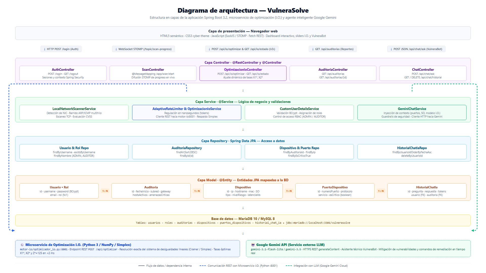
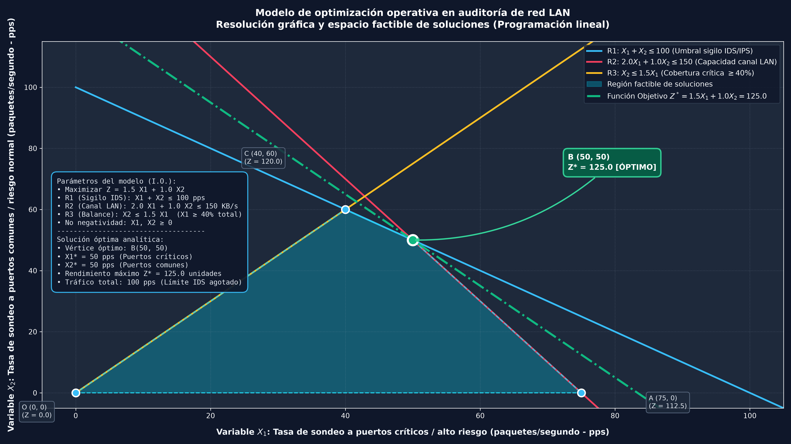
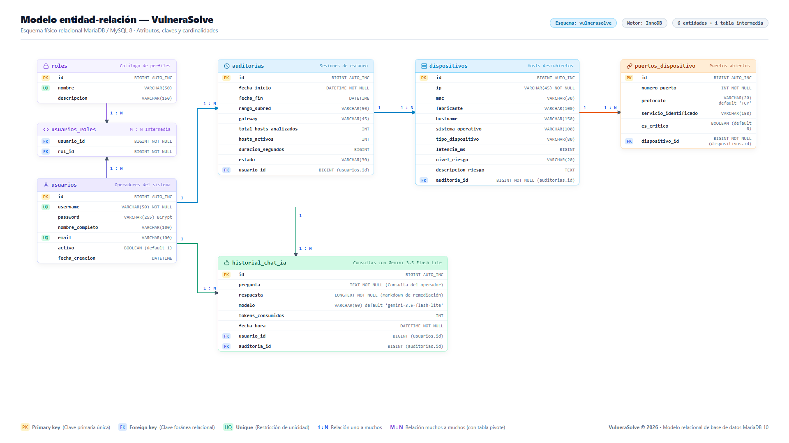

# 🛡️ VulneraSolve

> **Plataforma web de auditoría de seguridad en redes LAN asistida por Inteligencia Artificial y optimizada con Investigación de Operaciones.**

[](https://www.oracle.com/java/)
[](https://spring.io/projects/spring-boot)
[](https://www.python.org/)
[](https://mariadb.org/)
[](https://ai.google.dev/)
[](https://spring.io/projects/spring-security)

---

## 📌 ¿Qué es VulneraSolve?

En la mayoría de organizaciones y empresas, la seguridad suele centrarse en el perímetro exterior (Internet), descuidando lo que ocurre dentro de la propia red local (**LAN**). Equipos desactualizados, impresoras de red y puertos de comunicación abiertos sin control representan una puerta de entrada para ciberamenazas internas.

Realizar auditorías internas tradicionales suele ser complejo: las herramientas de consola arrojan datos difíciles de interpretar para no especialistas, y enviar paquetes de escaneo sin regulación puede saturar la red corporativa o activar bloqueos automáticos en los cortafuegos (*firewalls* e IDS/IPS).

**VulneraSolve** resuelve esta problemática uniendo tres áreas de la ingeniería en una sola plataforma web:
1. **Auditoría automatizada de red:** Descubre equipos activos y evalúa sus puertos TCP en segundos de forma concurrente.
2. **Optimización matemática (Investigación de Operaciones):** Calcula el ritmo óptimo de envío de paquetes para maximizar la detección sin saturar el canal ni activar alarmas perimetrales.
3. **Asistencia inteligente (VulneraBot con Google Gemini):** Interpreta los hallazgos técnicos y ofrece recomendaciones de remediación claras y comandos ejecutables listos para aplicar en Windows y Linux.

---

## 🚀 Características Principales

* 🔍 **Descubrimiento y Mapeo LAN:** Detección automática de interfaz de red, barrido de hosts activos mediante ARP e ICMP, y escaneo de puertos TCP clave (HTTP, HTTPS, SMB, RDP, FTP, Telnet, MySQL, etc.).
* ⚡ **Regulación Adaptativa de Tráfico:** Sistema `AdaptiveRateLimiter` en nanosegundos que evita ráfagas abruptas de tráfico mediante un algoritmo de cubeta de tokens (*token bucket*).
* 📐 **Motor de Optimización Simplex:** Microservicio independiente en Python que resuelve analíticamente el modelo matemático de I.O., con un motor de contingencia integrado en Java para máxima disponibilidad.
* 🎚️ **Modos de Escaneo Preconfigurados e Interactivos:**
  * **Modo Sigiloso (30 pps):** Diseñado para redes estrictas con firewalls sensibles.
  * **Modo Balanceado (100 pps):** Punto de equilibrio matemáticamente óptimo ($Z^* = 125$).
  * **Modo Agresivo (200 pps):** Máxima velocidad para laboratorios o pruebas controladas.
  * **Controles deslizantes manuales:** Permiten experimentar y personalizar las tasas en vivo desde el navegador.
* 🤖 **Asistente Técnico VulneraBot:** Chatbot integrado que recibe el contexto dinámico del escaneo y guía al administrador paso a paso en la mitigación de riesgos con guardrails de ciberseguridad defensiva.
* 📡 **Monitoreo en Tiempo Real:** Dashboard interactivo con WebSockets (STOMP) que refleja el porcentaje de avance, tiempos de respuesta y hallazgos en vivo.
* 🔒 **Seguridad Basada en Roles (RBAC):** Control de acceso con Spring Security 6 y contraseñas cifradas con algoritmo BCrypt.

---

## 🏗️ Arquitectura del Sistema

La solución está construida sobre una arquitectura desacoplada en capas:



### Capas y Componentes:
* **Frontend (Presentación):** HTML5 semántico, interfaz moderna con temática oscura de ciberseguridad, controles deslizantes interactivos y WebSockets STOMP para recibir notificaciones asíncronas en vivo.
* **Backend (Spring Boot 3.2):** Controladores REST y servicios de negocio protegidos con **Spring Security 6**. Orquesta el escaneo multihilo (`ThreadPoolExecutor`) y el regulador de tráfico (`AdaptiveRateLimiter`).
* **Motor Matemático (Python Microservice / `motor-io`):** Servicio ligero en Python (puerto `8001`) que resuelve el problema de programación lineal mediante álgebra exacta (Regla de Cramer / Simplex).
* **Capa de Persistencia (MariaDB 10):** Repositorios Spring Data JPA que almacenan usuarios, roles, auditorías, dispositivos descubiertos, puertos abiertos e historial del chat.
* **Capa de Inteligencia Artificial (Google Gemini Cloud):** Integración segura vía HTTP REST con modelos Gemini para proveer asesoría técnica defensiva contextualizada.

---

## 📈 Modelo de Optimización en Investigación de Operaciones (I.O.)

Para evitar que el escaneo sature el ancho de banda de la empresa o sea bloqueado por sistemas de detección de intrusos (IDS/IPS), el ritmo de transmisión se modela mediante **Programación Lineal**:



### Formulación Matemática:

* **Variables de decisión:**
  * $X_1$: Tasa de paquetes por segundo dirigidos a **puertos críticos** (21, 23, 445, 3389).
  * $X_2$: Tasa de paquetes por segundo dirigidos a **puertos comunes** (80, 443, 8080).

* **Función Objetivo:**
  $$\text{Maximizar } Z = 1.5 X_1 + 1.0 X_2$$
  *(Se prioriza la inspección de puertos críticos por su mayor impacto en la postura de seguridad).*

* **Restricciones del entorno:**
  1. **Capacidad del IDS/IPS:** $X_1 + X_2 \le 100 \text{ pps}$  
     *(Límite de paquetes por segundo para evitar detección por ráfaga).*
  2. **Ancho de banda seguro:** $2.0 X_1 + 1.0 X_2 \le 150 \text{ KB/s}$  
     *(Consumo de canal máximo equivalente a 1.20 Mbps, garantizando que no se degrade el tráfico corporativo).*
  3. **Equilibrio de cobertura:** $X_2 \le 1.5 X_1 \iff -1.5 X_1 + X_2 \le 0$  
     *(Garantiza que al menos el 40% del esfuerzo de sondeo cubra servicios de alta peligrosidad).*
  4. **No negatividad:** $X_1 \ge 0, \quad X_2 \ge 0$.

### Solución Óptima:
Al evaluar los vértices de la región factible:
* Vértice $O(0, 0) \implies Z = 0$
* Vértice $A(75, 0) \implies Z = 112.5$
* **Vértice $B(50, 50) \implies Z^* = 125.0$  ← [PUNTO ÓPTIMO]**
* Vértice $C(40, 60) \implies Z = 120.0$

> 💡 **Interpretación práctica:** La tasa óptima de escaneo es de **50 paquetes/s para puertos críticos y 50 paquetes/s para puertos comunes**. Esta combinación utiliza el 100% de la capacidad tolerada por el IDS (100 pps) y aprovecha exactamente el presupuesto de ancho de banda (150 KB/s), alcanzando la máxima eficiencia analítica posible.

---

## 🗄️ Modelo de Base de Datos

La información generada por cada auditoría se almacena de forma estructurada en MariaDB, garantizando integridad referencial y trazabilidad histórica:



* **`usuarios` y `roles`:** Control de acceso basado en roles con credenciales cifradas en BCrypt.
* **`auditorias`:** Registro de cada escaneo ejecutado (fecha, subred, duración, total de equipos y amenazas detectadas).
* **`dispositivos`:** Detalle de cada host descubierto (IP, MAC, sistema operativo inferido, nivel de riesgo).
* **`puertos_dispositivo`:** Inventario de puertos TCP abiertos por host, indicando severidad y servicio asociado.
* **`historial_chat_ia`:** Registro persistente de consultas y recomendaciones generadas por VulneraBot.

---

## 🤖 El Asistente Técnico: VulneraBot

VulneraBot es un agente interactivo integrado en el panel principal que actúa como un asesor de seguridad de cabecera:

* **Inyección Dinámica de Contexto:** Cuando el usuario consulta a VulneraBot, el sistema recopila automáticamente los datos del escaneo activo (hosts, puertos abiertos, fallas críticas) y los introduce en la instrucción del modelo.
* **Guardrails de Ciberseguridad Defensiva:** El modelo cuenta con instrucciones estrictas de sistema para orientar sus respuestas **exclusivamente a la protección y remediación** (comandos de firewall, cierre de puertos, parches), rechazando solicitudes orientadas a ataques o intrusión.
* **Recomendaciones Accionables:** Ofrece comandos exactos listos para copiar y ejecutar en PowerShell, CMD, Bash o `ufw/iptables`.

---

## 🔐 Control de Acceso y Roles (RBAC)

Al inicializar la aplicación, se configuran perfiles con permisos diferenciados:

| Usuario | Contraseña | Rol | Permisos |
| :---: | :---: | :---: | :--- |
| **`antonio`** | `antonio` | `ROLE_ADMIN` | **Administrador:** Iniciar y cancelar escaneos, configurar optimización, consultar auditorías y chatear con VulneraBot. |
| **`jose`** | `jose` | `ROLE_ADMIN` | **Administrador:** Control total de auditorías y configuración técnica. |
| **`giovanny`** | `giovanny` | `ROLE_AUDITOR` | **Auditor (Lectura):** Visualizar reportes históricos, consultar inventario de puertos y chatear con la IA. *(No puede iniciar escaneos)*. |
| **`jesus`** | `jesus` | `ROLE_AUDITOR` | **Auditor (Lectura):** Acceso a métricas históricas y asistencia de VulneraBot. |

---

## 📡 Resumen de la API REST

| Método | Endpoint | Rol Requerido | Descripción |
| :---: | :--- | :---: | :--- |
| `GET` | `/api/auth/me` | Autenticado | Obtiene la información y rol del usuario en sesión. |
| `POST` | `/api/scan` | `ROLE_ADMIN` | Inicia un nuevo escaneo asíncrono en la red local. |
| `GET` | `/api/status` | Autenticado | Consulta el estado operativo del escáner. |
| `GET` | `/api/auditorias` | Autenticado | Lista el historial de auditorías realizadas. |
| `GET` | `/api/auditorias/{id}` | Autenticado | Detalle completo de una auditoría, sus hosts y puertos. |
| `POST` | `/api/io/optimizar` | `ROLE_ADMIN` | Envía parámetros al microservicio de I.O. y actualiza las tasas de escaneo. |
| `GET` | `/api/io/estado` | Autenticado | Consulta las tasas de transmisión vigentes y disponibilidad de I.O. |
| `POST` | `/api/chat/ask` | Autenticado | Envía una consulta técnica contextualizada a VulneraBot. |
| `GET` | `/api/chat/historial` | Autenticado | Recupera el historial de conversación del usuario. |
| `DELETE` | `/api/chat/historial` | Autenticado | Limpia el historial de chat del usuario actual. |
| `WS` | `/ws` (`/topic/scan`) | Autenticado | Canal WebSocket para eventos de progreso en tiempo real. |

---

## 🚀 Guía Rápida de Instalación y Ejecución

### Prerrequisitos:
* **Java:** JDK 21 o superior.
* **Maven:** 3.8 o superior.
* **Python:** 3.10 o superior (con `numpy` instalado para el microservicio de I.O.).
* **MariaDB / MySQL:** Servicio activo en el puerto `3306`.

---

### Paso 1: Configurar la Base de Datos
Crea la base de datos en MariaDB ejecutando:
```sql
CREATE DATABASE vulnerasolve CHARACTER SET utf8mb4 COLLATE utf8mb4_unicode_ci;
```
*(Las tablas, roles y usuarios iniciales se generan automáticamente al iniciar Spring Boot).*

---

### Paso 2: Clave de Google Gemini (Opcional)
Para habilitar el chat con inteligencia artificial de VulneraBot, define la variable de entorno:

```powershell
# Windows (PowerShell)
$env:GEMINI_API_KEY="tu_api_key_aqui"

# Linux / macOS
export GEMINI_API_KEY="tu_api_key_aqui"
```
*(Si no dispones de clave, el sistema arrancará con normalidad y VulneraBot responderá con directrices locales de contingencia).*

---

### Paso 3: Puesta en Marcha

Se recomienda abrir dos terminales:

```bash
# Terminal 1: Iniciar microservicio de optimización matemática (I.O.)
python motor-io/optimizador_io.py
```

```bash
# Terminal 2: Compilar y arrancar la plataforma web en Spring Boot
cd backend
mvn clean install
mvn spring-boot:run
```

> ℹ️ **Nota de resiliencia:** Si ejecutas únicamente el backend de Java, VulneraSolve activará de forma transparente su **resolvedor simplex de contingencia integrado**, garantizando que la optimización y el escaneo funcionen sin interrupciones.

---

### Paso 4: Acceder a la Plataforma
Abre tu navegador web en:
👉 **`http://localhost:8080`**

Inicia sesión con cualquiera de las cuentas del sistema (ejemplo: usuario `antonio` / contraseña `antonio`).

---

## 📂 Estructura del Proyecto

```text
Escaner-de-red-2.0/
├── backend/
│   ├── src/main/java/com/escaner/
│   │   ├── config/             # Configuración de WebSockets y carga de datos iniciales
│   │   ├── controller/         # Endpoints REST (Auth, Scan, Auditoria, Chat, I.O.)
│   │   ├── entity/             # Entidades JPA (Auditoria, Dispositivo, Puerto, etc.)
│   │   ├── repository/         # Interfaces de persistencia Spring Data JPA
│   │   ├── security/           # Configuración de seguridad Spring Security 6 y RBAC
│   │   └── service/            # Lógica de escaneo LAN, RateLimiter, Gemini y cliente I.O.
│   ├── src/main/resources/
│   │   ├── static/             # Frontend web (HTML5, CSS3, JavaScript STOMP)
│   │   └── application.properties # Parámetros de conexión a MariaDB y API Gemini
│   └── pom.xml                 # Dependencias del proyecto Maven
├── motor-io/
│   └── optimizador_io.py       # Microservicio Python de Programación Lineal (Simplex/NumPy)
├── docs/
│   └── img/                    # Diagramas de arquitectura, modelo E-R, I.O. y árbol de problema
└── README.md                   # Documentación oficial del proyecto
```

---

## 👥 Equipo de Desarrollo

Proyecto desarrollado en el marco del programa de **Ingeniería de Sistemas — VII Semestre** en la **Fundación Universitaria Tecnológico Comfenalco** (Cartagena de Indias, Colombia):

* **Antonio Luis De Oro Vergara**
* **Giovanny Daniel Gonzales Racero**
* **José Luis Garay De La Vega**
* **Jesus David Noriega Blanco**

* **Docentes Asesores:** Ing. Fabio G. Ramirez y Lucia M. Tapia  
* **Asignaturas Integradoras:** Desarrollo Web Avanzado e Investigación de Operaciones  
* **Año Académico:** 2026
